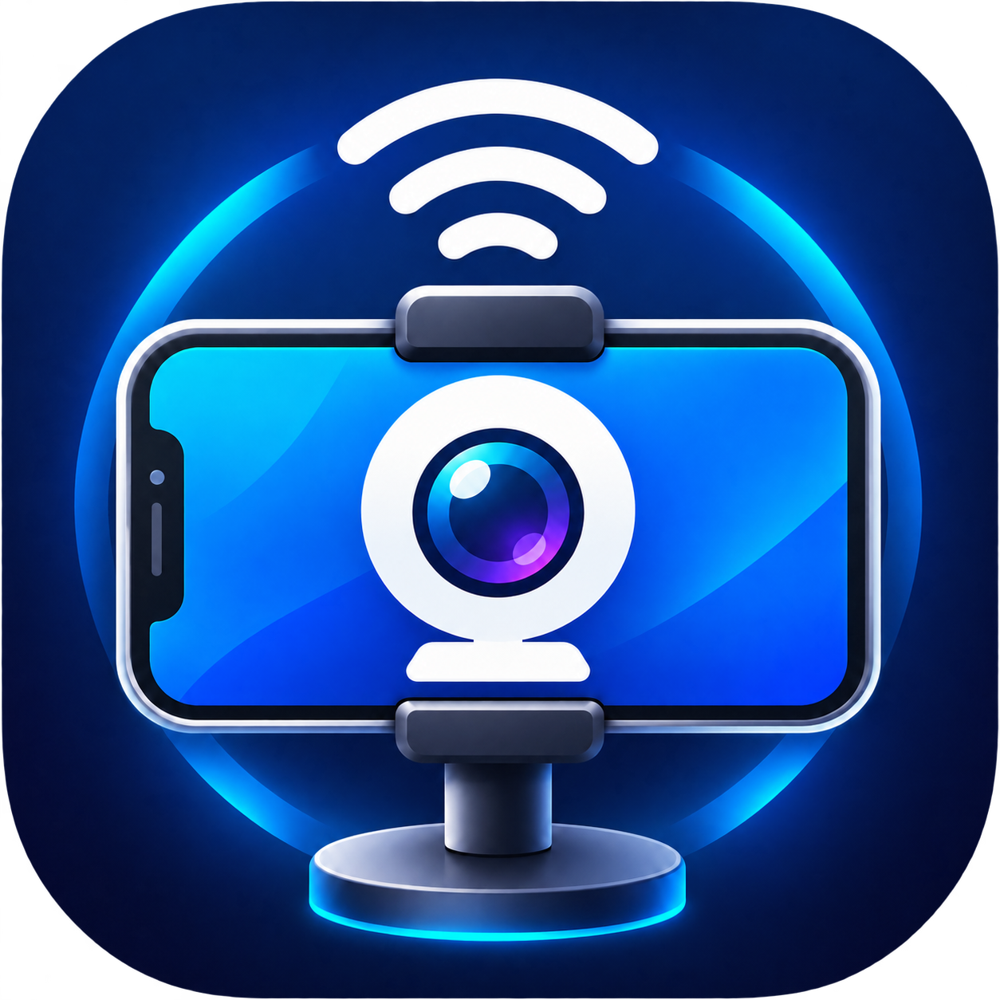

# Hamijeu - Webcam Mobile V1.0 beta



Aplikasi Android untuk mengubah ponsel menjadi kamera CCTV foto berkala, sepenuhnya offline. Foto disimpan di perangkat, tanpa server, Wi-Fi, akun, atau izin internet. Nama Webcam Mobile tidak berarti aplikasi ini menyediakan streaming webcam: versi beta ini mengambil foto berkala.

## Instalasi Langsung

1. Buka [halaman rilis V1.0 beta](https://github.com/hamijeu/webcam-mobile/releases/tag/v1.0-beta).
2. Unduh APK **Hamijeu - Webcam Mobile V1.0 beta.apk** pada bagian Assets.
3. Izinkan instalasi aplikasi dari sumber tersebut, kemudian pasang APK.
4. Buka aplikasi dan berikan izin kamera, notifikasi, serta penyimpanan jika diminta.
5. Atur interval, batas penyimpanan, resolusi, exposure, dan mode, lalu mulai pengambilan foto dari aplikasi.

Memerlukan Android 8.0 atau lebih baru. APK beta menggunakan debug signing untuk pengujian, bukan kunci rilis produksi. Pembaruan harus menggunakan kunci penandatangan yang sama; jangan uninstall bila ingin mempertahankan data aplikasi.

## Fitur

- Interval foto dengan angka custom, minimal 2 detik.
- Batas penyimpanan custom dalam GB, minimal 0.1; perhitungan internal memakai 1024 pangkat 3 byte.
- Penghapusan foto tertua dalam folder aplikasi ketika batas terlampaui.
- Resolusi rendah, menengah, dan tinggi sesuai kemampuan kamera.
- Preview kamera dan exposure otomatis dengan kompensasi -4 sampai +4, dibatasi kemampuan perangkat.
- Pengaturan tersimpan saat aplikasi ditutup.
- Mode layar hitam dan mode berjalan saat layar terkunci.
- Timestamp permanen pada foto: `yyyy-MM-dd HH:mm:ss`, mengikuti jam dan zona waktu ponsel, tanpa koneksi internet.
- Foreground service dengan notifikasi selama pengambilan foto.

## Lokasi Foto

- Android 8-9: `Pictures/OfflineCCTV` pada penyimpanan bersama.
- Android 10+: folder Pictures milik aplikasi, biasanya `Android/data/com.hamijeu.offlinecctv/files/Pictures/OfflineCCTV`.
- Jika penyimpanan eksternal aplikasi tidak tersedia, aplikasi memakai folder internalnya.

Pada Android baru, akses folder Android/data dari pengelola berkas dapat dibatasi. Data pada folder khusus aplikasi akan terhapus saat uninstall. Salin foto penting sebelum uninstall atau menghapus data aplikasi.

## Batasan Beta

- Pengambilan foto saat layar terkunci bergantung pada kebijakan kamera dan penghemat baterai produsen. Mulai sesi saat aplikasi masih terbuka; tidak ada jaminan berjalan tanpa henti pada semua perangkat.
- Aplikasi tidak otomatis mulai setelah reboot, tidak merekam video/audio, dan tidak mengunggah foto.
- Wake lock saat ini dibatasi 12 jam per sesi. Periksa perangkat secara berkala untuk penggunaan panjang.
- Timestamp membakar ulang JPEG, sehingga ada biaya pemrosesan/memori dan kompresi ulang. Jam yang salah di ponsel menghasilkan timestamp yang salah.
- Tidak ada jaminan preview dan JPEG persis sama karena pemrosesan kamera perangkat berbeda.
- Uji pada perangkat target sebelum dipakai untuk pemantauan penting. Android 15 belum dinyatakan lulus uji fisik dalam rilis ini.
- Gunakan hanya di lokasi yang diizinkan dan hormati privasi orang lain. Mode layar hitam bukan pengganti kunci keamanan Android.

## Build Dan Pengujian

Proyek Java native dengan Camera2, Android Gradle Plugin 8.6.1, Gradle 8.7, JDK 17, dan Android SDK 35.

```powershell
$env:ANDROID_HOME = "$env:LOCALAPPDATA\Android\Sdk"
.\gradlew.bat testDebugUnitTest assembleDebug
```

Gradle Wrapper 8.7 disertakan, atau buka folder proyek melalui Android Studio. Build pertama memerlukan internet untuk mengunduh Gradle dan dependensi; penggunaan aplikasi tetap offline. APK dihasilkan pada `app/build/outputs/apk/debug/app-debug.apk`.

Unit test mencakup parsing pengaturan, pemilihan resolusi, penamaan foto, batas penyimpanan, dan format timestamp. Unit test bukan pengganti pengujian kamera dan background service pada perangkat fisik.

## Struktur

- `MainActivity`: kontrol, preview, izin, dan preferensi.
- `CaptureService`: sesi kamera dan pengambilan foto berkala.
- `StorageCleaner`: pembatasan ukuran folder foto.
- `OverlayRenderer` / `OverlayText`: timestamp offline.

Dibuat untuk proyek portofolio **hamijeu**. Tidak ada lisensi open-source yang diberikan dalam repositori ini; hak penggunaan mengikuti izin pemilik.
